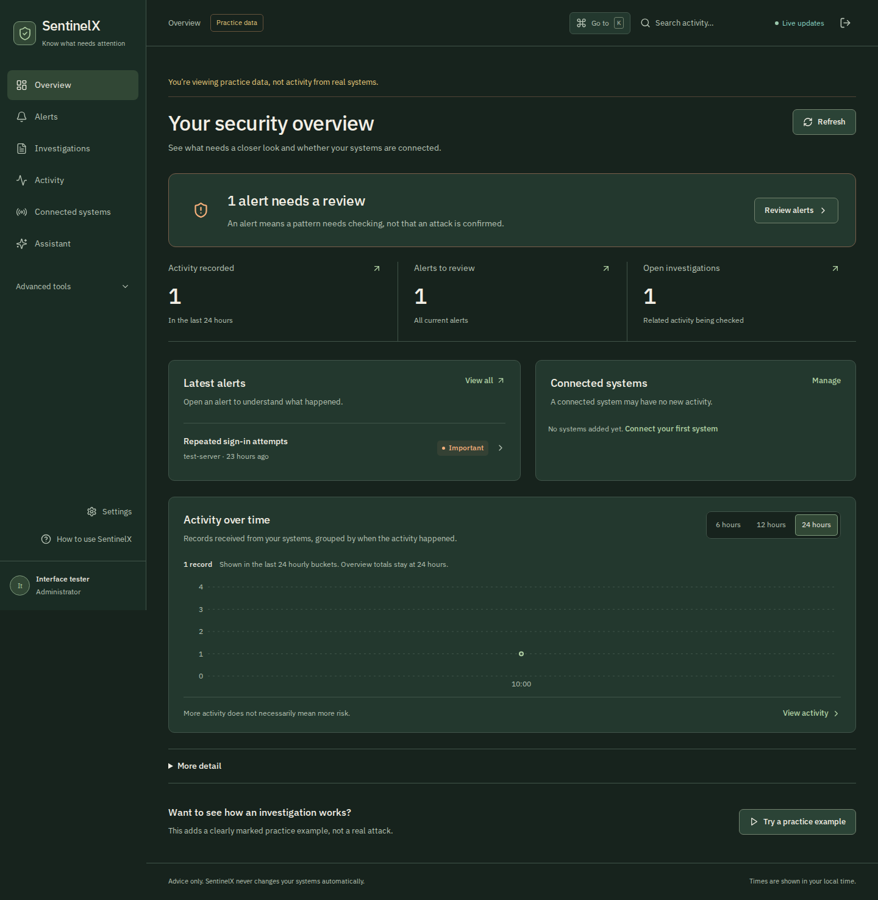

# SentinelX

SentinelX collects logs from Linux machines, websites, and applications. It checks them against detection rules, creates alerts, and groups related activity into investigations.

It is a learning project, not a replacement for a production security platform. The default setup runs on localhost.



*Interface preview using practice data. No live logs are shown.*

## What it does

- Reads Linux authentication logs, Nginx/Apache access logs, and structured application logs.
- Detects patterns such as repeated failed sign-ins, privileged activity, and unusually high HTTP error rates.
- Lets you search activity, review alerts, and follow an investigation timeline.
- Keeps notes, linked evidence, assignments, and status changes together.
- Shows whether a connected system is sending activity or needs attention.
- Provides administrator, investigator, and read-only access.
- Includes a keyboard page picker, chart time windows, and connection filters.

## Get it running

You need Python 3, Docker, and the Docker Compose plugin. Port `8080` should be available.

```bash
git clone https://github.com/aadvik1864/sentinelx.git
cd sentinelx
python3 scripts/init_env.py
docker compose up --build --wait
```

Open **http://localhost:8080** and sign in:

- **Email:** `admin@sentinelx.dev`
- **Password:** the `BOOTSTRAP_ADMIN_PASSWORD` value in your generated `.env` file

Each installation gets its own generated passwords and keys. There is no shared default password. Keep `.env` private; the setup script will not overwrite it if it already exists.

To give someone access, use **Settings → Add a person**. New accounts start read-only. They can see the workspace's alerts and investigation notes, so only add people you trust.

### Try the practice example

The default setup includes sample activity. On the overview page, choose **Try a practice example**, open the resulting investigation, and review its timeline. You can add a note, assign it, or close it when you finish reviewing it.

Practice activity is simulated inside SentinelX. It does not attack or contact another system.

### Connect real systems

Go to **Connected systems → Connect a system** and follow the setup instructions on the machine that holds the logs.

A website URL is not enough—you need access to its server logs. Each connection gets a private key that can submit activity only for that connection.

Follow the [monitoring guide](docs/monitoring.md) before switching to live collection. It uses a separate database and disables practice activity so the two histories do not mix. The collector saves its position and retries interrupted deliveries, but it cannot recover logs that disappear before it reads them.

### Optional investigation helper

The assistant can explain the evidence already linked to an alert or investigation. It runs when you choose **Explain**; it does not run on every log record. Detection still uses rules, and the assistant cannot block addresses, execute commands, or change a monitored system.

See [assistant setup and data handling](docs/local-ai.md) for the local option and optional external providers. Read the privacy notes before enabling an external service.

### Finding your way around

Use **Go to** or **Ctrl/⌘ + K** to open a page by name. The overview chart switches between 6, 12, and 24 hours, and Connected systems lets you search connections or show only the ones needing attention. These controls change the view, not your data or collection settings.

## Built with

| Part | Tools |
|---|---|
| Frontend | React, TypeScript, Vite, Tailwind CSS |
| Backend | Python, FastAPI, Pydantic, SQLAlchemy, Alembic |
| Storage and updates | PostgreSQL, Redis, WebSockets |
| Deployment | Docker Compose, Nginx |
| Tests | pytest, Vitest, Playwright |

## Working on the project

For development without Docker, use Python 3.12 and Node.js 22.12 or newer. SQLite is supported for local development.

From the repository root:

```bash
python3 scripts/init_env.py
python3 -m venv .venv
.venv/bin/pip install -r backend/requirements.txt
```

Skip the first command if `.env` already exists. These instructions assume a fresh development configuration; keep live collection on its existing database and deployment.

Start the backend in one terminal:

```bash
cd backend
../.venv/bin/alembic upgrade head
../.venv/bin/uvicorn app.main:app --reload --host 127.0.0.1 --port 8000
```

Start the frontend in another:

```bash
cd frontend
npm ci
npm run dev
```

Open **http://localhost:5173**. API documentation is disabled by default; private development can enable `/api/docs` with `API_DOCS_ENABLED=true`.

### Run the checks

Backend, from `backend/`:

```bash
../.venv/bin/pytest -q
```

Frontend, from `frontend/`:

```bash
npm test
npm run lint
npm run build
```

Browser checks need a running application:

```bash
npx playwright install chromium
npm run test:e2e
```

Some browser checks need an administrator password supplied privately through `SENTINELX_E2E_PASSWORD`. Tests that change practice data skip when live monitoring is enabled. PostgreSQL tests require a **separate disposable database** through `TEST_DATABASE_URL`—they recreate tables, so never point them at a live database.

## Before using real logs

Keep the default deployment local. Before remote access, configure trusted HTTPS, review who can sign in, and read the [deployment guide](docs/deployment.md) and [security boundaries](docs/security.md).

This is one shared workspace, not separate customer accounts. It does not include automatic containment, retention jobs, or tamper-proof audit storage. An empty alert list does not prove that a system is safe or fully monitored.

Do not commit credentials, collected logs, database files, backups, or private screenshots. The repository includes examples and practice previews, not the files from a running installation.

## More detail

- [Connecting and monitoring systems](docs/monitoring.md)
- [Detection rules](docs/detection-rules.md)
- [Collector behavior and delivery limits](docs/collectors.md)
- [API and permissions](docs/api.md)
- [Architecture](docs/architecture.md)
- [Deployment and backups](docs/deployment.md)
- [Security boundaries](docs/security.md)

## License

SentinelX's own code is [MIT licensed](LICENSE). Adapted React Bits components retain their [MIT + Commons Clause license](frontend/src/components/react-bits/LICENSE.md). Their notices are included in the application.
