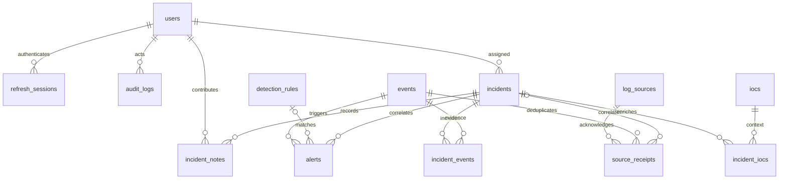

# Database relationships

Schema source: `backend/app/models/__init__.py`. Reproducible migrations: `backend/migrations/versions/`.

| Table | Key data |
|---|---|
| users | Unique normalized email, Argon2id hash, role, authentication version |
| refresh_sessions | Session/family UUIDs, hashed refresh token, expiration, consumed/revoked flags |
| events | UTC occurrence/receipt times, normalized fields, JSON metadata |
| log_sources | Registered kind/hostname/path, hashed collector credential, enabled flag, heartbeat/error and accepted-record counters |
| source_receipts | Composite source/record-key primary key, payload digest, event and optional incident; committed with ingestion |
| detection_rules | Pattern kind, event type, threshold/window, enabled flag, severity, techniques/config |
| alerts | Triggering event, nullable rule, correlated incident, source/host, count, severity/status |
| incidents | Title/description, owner, source/host, severity/status, techniques, last-seen/resolution times |
| incident_events | Composite incident/event primary key; duplicate evidence prevented |
| incident_notes | Author, plain text, note/evidence kind, timestamp |
| assets | Unique hostname, IP, type, environment, owner, administrator-configured status |
| iocs | Unique type/value, provenance, reputation, nullable provider score, context and cache times |
| incident_iocs | Composite incident/IOC primary key |
| audit_logs | Actor, action/resource/reference, client IP, timestamp, change metadata |

Foreign keys protect evidence. Deleting a rule sets `alerts.rule_id` to null while retaining alert titles, descriptions, mappings, and triggering events. The API does not delete security events or incidents. SQLite foreign-key enforcement is explicitly enabled.

All stored timestamps are naive UTC in the database and serialized with `Z` at the API boundary. Inputs require explicit timezone offsets and normalize to UTC. Display references derive from integer primary keys, not a separate writable identifier.

Important indexes: event source/hostname/type/time grouping, event time/source/severity, alert rule/source/host/detection time suppression, incident source/status, unique IOC type/value, and refresh-session family/user lookups.
